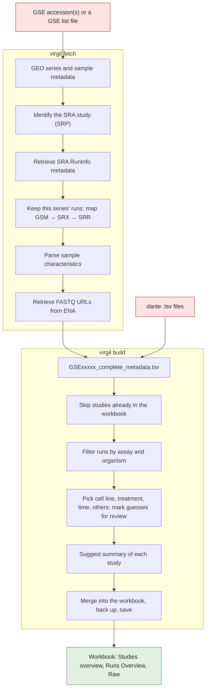

# Virgil

Fetches run metadata from GEO studies and creates (or updates) one workbook

## Features

`virgil` currently can:

- Download GEO and SRA metadata for one study, a list of studies, or a text
  file of GSE numbers or read files already made by `dante`.
- Keep only the runs that belong to each series, even when an SRA study is
  shared with other GEO series.
- Add FASTQ links from ENA (`fastq_ftp`, `fastq_aspera`, `fastq_md5`).
- Keep going when a study fails and list the failures with the reason in `failed.txt`.
- Filter runs by assay and organism (ATAC-seq and Homo sapiens by default).
- Pick out the cell line, treatment, time and other conditions for each run,
  whatever each study calls them, using lists of field names in the settings.
- Split a time out of the treatment text (`20 mM NAG for 24h` → `20 mM NAG`, `24h`).
- Suggest a summary of each study: cell lines, number of conditions, samples and runs,
  library layout, and a suggested comparison.
- Merge new studies into an existing workbook without touching rows already
  there, back up the workbook before each save, and redo a single study on request.
- Link every SRR, GSE and PubMed ID to its page.

## Workflow



## Installation

### Mac/Linux

Needs Python 3.8 or newer.

1) On a Mac, install Python from [python.org](https://www.python.org/downloads/) or with Homebrew (`brew install python`). Most Linux systems already have it.

> [!NOTE]
> **Mac: "Certificate error".** Python from python.org doesn't come with the certificates it needs for secure downloads. Open **Finder →** 
> **Applications → Python 3.x** and double-click **Install Certificates.command**, then try again. This only has to be done once. (Or delete and use 
> brew)

2) Open terminal where you want virgil to download, then enter below commands

```bash
git clone https://github.com/SnowCattss/virgil.git
cd virgil
git checkout v0.1.2             # the released version; leave out for the newest code (might cause breakage)
python3 -m venv .venv
source .venv/bin/activate
pip install .
cp settings.example.yaml settings.yaml
```

> [!NOTE]
> Each new terminal needs `source .venv/bin/activate` (from the `virgil` folder) before `virgil` will run.

### Windows

Needs Python 3.8 or newer.

1) Download Python from [python.org/downloads](https://www.python.org/downloads/)

> [!IMPORTANT]
> Check "Add python.exe to PATH" on the first screen before clicking install
2) Open the downloaded file (e.g. `python-3.x.x-amd64.exe`) and install


3) Download and install Git from [git-scm.com/downloads/win](https://git-scm.com/downloads/win)

4) Open cmd where you want virgil to download, then enter below commands

```bat
git clone https://github.com/SnowCattss/virgil.git
cd virgil
git checkout v0.1.2
py -m venv .venv
.venv\Scripts\activate
pip install .
copy settings.example.yaml settings.yaml
```

## Use

```bash
virgil fetch GSE123456 123456           # download studies into tsv_dir (GSE can be left out)
virgil fetch --gse-file gses.txt        # download every GSE in a text file (Accepts comma, semicolon, newline, or space separation)
virgil fetch GSE123456 --out dir_path   # change the destination of .tsv files 

virgil build                            # add new studies in tsv_dir to the workbook (will create it if none)
virgil build --fetch GSE123456          # download given, then build workbook (GSE can be left out)
virgil build --gse-file gses.txt        # download from list, then build workbook (Accepts comma, semicolon, newline, or space separation)
virgil build --redo 123456              # remove a study from the workbook and add it again
virgil build -v                         # also list each run that needs review, and why
virgil build --no-links                 # does not offer to open links for new studies, also in settings.yaml

virgil --help                           # the commands
virgil fetch --help                     # fetch switches
virgil build --help                     # build switches 
```

## How it's built
| File          | Job                                                  |
| ------------- | ---------------------------------------------------- |
| `cli.py`      | the `virgil fetch` / `virgil build` commands         |
| `fetch.py`    | download from GEO, SRA and ENA & write the .tsv files|
| `settings.py` | load `settings.yaml`                                 |
| `reader.py`   | read the .tsv files                                  |
| `extract.py`  | the rules that make each overview row                |
| `workbook.py` | write and merge the Excel workbook                   |
| `links.py`    | offer to open GEO pages                              |
| `deps.py`     | check that openpyxl and pyyaml are installed         |


## Known limitations

- Downloading is slow for big studies: FASTQ links are looked up once per run.
- Renamed sheets, renamed headers or moved columns aren't detected; `build` either stops with an error (without changing the file) or writes new rows under the wrong headers.
- Conditional formatting added in Excel is removed on the next build.

See the issues page for the full list.


## Credit

Fetching follows the approach of [dante](https://github.com/VanBortleLab/dante)(VanBortle Lab). 
Data comes from NCBI GEO, NCBI SRA and ENA.

## License

MIT, see `LICENSE`.
